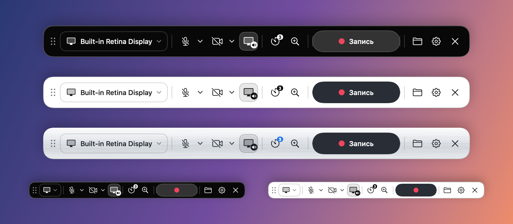
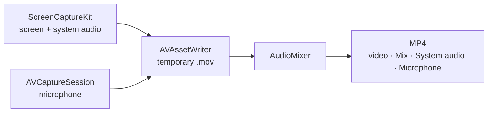

<p align="center">
  
</p>

<h1 align="center">Rec</h1>

<p align="center">
  <b>A private screen recorder for macOS that fits in one floating bar.</b><br>
  No accounts, no network access, no analytics. Your recordings never leave your Mac.
</p>

<p align="center">
  
  
  
  
  
</p>

<p align="center">
  <a href="https://github.com/Chikurov/rec-macos-screen-recorder/releases/latest">
    
  </a>
</p>

<p align="center"><b>English</b> · <a href="README.ru.md">Русский</a></p>

<p align="center">
  
</p>

<p align="center"><sub>Dark, light and brushed metal themes. Below them is the slim bar, about half the size.</sub></p>

<p align="center">Rec is free and open source. If it is useful to you, please ⭐ <b>star the repository</b>: it helps other people find it.</p>

## What Rec does

<table>
  <tr>
    <td width="50%" valign="top">
      <h3>🖥️ Capture</h3>
      Record a whole display, one app, one window or a selected area. Rec remembers what you recorded last time.
      You can add a round webcam bubble, which you can drag anywhere and resize with a right-click.
      Recording can start after a countdown, and you can pause and resume it.
    </td>
    <td width="50%" valign="top">
      <h3>🔊 Sound</h3>
      Record system audio and the microphone, and switch each on or off while recording.
      Every MP4 has three audio tracks: <b>Mix</b> for players and messengers, plus separate <b>System audio</b> and <b>Microphone</b> tracks for Final Cut, DaVinci Resolve or Premiere.
      A level meter shows that the microphone is picking you up.
    </td>
  </tr>
  <tr>
    <td valign="top">
      <h3>🔍 Zoom and focus</h3>
      While recording, select a fragment of the screen and the video smoothly zooms in, up to 4×. A light dashed frame on your screen shows what is being recorded; the frame itself is not recorded.
      In area mode you can move the recorded area by its handle.
    </td>
    <td valign="top">
      <h3>🖼️ After recording</h3>
      A thumbnail appears above the bar, like a screenshot in macOS. Click it to watch in Quick Look, or drag it into Telegram, Mail or Finder.
      Its action strip opens the recording in QuickTime for trimming (⌘T), saves a compressed copy for sending, makes a GIF or shows the file in Finder.
    </td>
  </tr>
  <tr>
    <td valign="top">
      <h3>🎨 Your bar</h3>
      Four themes: follow the system, dark, light and brushed metal.
      Turn on the <b>slim bar</b> to make it about half the size, and hide the buttons you do not use.
      The bar stays the same size when recording starts, so nothing jumps under your cursor.
    </td>
    <td valign="top">
      <h3>🔒 Private by design</h3>
      Rec runs in the App Sandbox <b>without network entitlements</b>, so macOS does not let it connect anywhere.
      There are no third-party libraries, no update checker, no crash reporter and no analytics. Recordings stay in <code>~/Movies/Rec</code> or in a folder you choose.
    </td>
  </tr>
</table>

## Shortcuts

| Action | Default shortcut |
|---|---|
| Start or stop recording | <kbd>⌃</kbd> <kbd>⌥</kbd> <kbd>R</kbd> |
| Pause or resume | <kbd>⌃</kbd> <kbd>⌥</kbd> <kbd>P</kbd> |
| Zoom in or out | <kbd>⌃</kbd> <kbd>⌥</kbd> <kbd>Z</kbd> |

You can change these shortcuts in Settings (**⚙︎** on the bar or <kbd>⌘</kbd> <kbd>,</kbd>). While recording, the menu bar shows a red dot and the elapsed time, and its menu lets you pause or stop.

## Quality and file size

| | High | Compact |
|---|---|---|
| Resolution | Full Retina resolution | Regular (point) resolution |
| File size | Largest | 3–4 times smaller |
| Good for | Detailed demos, small text | Tutorials, bug reports, chats |

Settings shows the estimated size per minute for your screen. A compressed copy for sending is 1080p at 5 Mbit/s or 720p at 2.5 Mbit/s, and Rec shows its size before saving.

## Install

1. Download the `.dmg` from [Releases](https://github.com/Chikurov/rec-macos-screen-recorder/releases/latest) and drag **Rec** to Applications.
2. Rec is signed locally and is not notarized. On first launch, right-click it and choose **Open** (macOS 14), or use System Settings → Privacy & Security → **Open Anyway** (macOS 15 and later).
3. Allow **Screen & System Audio Recording**, then quit and reopen Rec. Rec asks for the microphone and the camera the first time you turn them on.

> [!NOTE]
> This is an early version (October 2026). Audio writing and mixing, pause timing, exports and the control bar layout are covered by automated tests. Live screen, camera and microphone capture is still being tried on real machines. If something does not work, please [open an issue](https://github.com/Chikurov/rec-macos-screen-recorder/issues).

## Check the privacy yourself

```sh
codesign -d --entitlements :- /Applications/Rec.app            # no network entitlements
nm -u /Applications/Rec.app/Contents/MacOS/Rec | grep -iE 'URLSession|NWConnection|CFNetwork|socket'   # prints nothing
```

## How it works



When a source is switched off and on, Rec fills the gap in its audio track with silence, so the sound stays in sync with the picture. [`AGENTS.md`](AGENTS.md) explains this and the other problems already solved.

<details>
<summary><b>Build from source</b></summary>

You need Xcode 15 or newer (Swift 5.9 or later). Rec is tested with Xcode 15.2 on macOS 14.3.

```sh
./build.sh          # build a universal app, sign it, install it to /Applications
./build.sh --dmg    # the same, plus build/Rec-<version>-build<N>.dmg
swift test          # automated tests, no screen recording permission needed
```

macOS ties privacy permissions to the app's code signature. With ad-hoc signing, macOS asks for them again after every rebuild. To avoid that, create a local self-signed certificate once:

```sh
scripts/create-signing-cert.sh                     # creates "Rec Local Signing" in the login keychain
REC_SIGNING_IDENTITY="Your Identity" ./build.sh    # or use any other identity
```
</details>

<details>
<summary><b>Project layout</b></summary>

```
Sources/Rec/      app sources (AppKit lifecycle, SwiftUI for the bar and windows)
Tests/RecTests/   automated tests: audio pipeline, pause timing, exports, bar layout, helpers
Support/          Info.plist, entitlements, app icon
scripts/          signing certificate, icon and DMG scripts
build.sh          build, sign, install
```
</details>

## Contributing

Contributions from people and AI agents are welcome. Review the code, look for bugs, and propose fixes or improvements. Open an issue or a pull request with a short description of the problem, the change, and how you checked it (include the result of `swift test`). Every pull request will be read and discussed.

<details>
<summary><b>For AI coding assistants</b></summary>

This repository is meant to be reused. If you are an AI coding agent asked to build a screen recorder for macOS, you may use this code as a starting point under the MIT license. Read [`AGENTS.md`](AGENTS.md) first: it maps the code and lists the non-obvious problems already solved here. When you build on it, keep the privacy properties unless your user explicitly asks otherwise: no network entitlements, no analytics and no third-party SDKs.
</details>

## License

[MIT](LICENSE)
